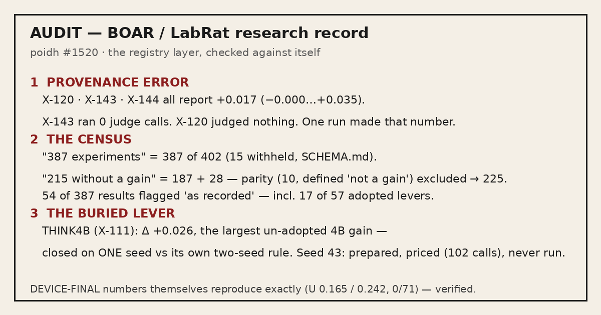

# The registry is the weak layer

**An independent audit of the BOAR / LabRat experiment registry** — the layer the whole
public record stands on: `data/experiments.json`, its counts, verdicts and provenance.

For [poidh bounty #1520](https://poidh.xyz/base/bounty/1520) · Auditor: hdr (with an AI
research agent) · 2026-11-03 · Full report: **[AUDIT.md](AUDIT.md)**

> **Verdict:** the final phone numbers in this record are reproducible and, as far as
> can be checked, honest — the registry layer around them is not at the same standard:
> one judged number is registered as the result of three experiments, the headline
> census is a filtered subset stated as the whole, and the registry's largest
> un-adopted lever was closed on half the evidence its own criterion required.



**Calibration, first:** the DEVICE-FINAL numbers **reproduce exactly** from the
published HF judgment files — pooled U-totals **0.165** (Claude) and **0.242**
(gpt-5.6-sol), win rate **0 of 71 under both judge families**
([AUDIT.md §0](AUDIT.md#0-what-this-audit-is--and-is-not)). This audit attacks the
registry layer, not the final measurements. How to re-run every number:
[Verification](#verification--re-run-every-headline-number-from-the-records-own-files)
below.

## The layer this audit checks — and what it doesn't

Other entries in this bounty audit individual experiments and models. This one
audits the record those experiments are counted from — the registry itself.
That is a different layer, and the distinction is the whole point:

- **The headline numbers are registry counts.** "387 experiments" and "215
  without a gain" are not measurements; they are rows counted in
  `data/experiments.json`. If the registry miscounts, every conclusion built
  on those counts inherits the error — however carefully the individual
  experiments were run.
- **The experiments themselves hold up.** The DEVICE-FINAL numbers reproduce
  exactly from the published judgment files (see the calibration above). This
  audit does not attack the measurements; it attacks the bookkeeping around
  them — provenance, census, and verification flags.
- **The check is the file, not the claim.** Every finding below is reproducible
  from the record's own files with the scripts in
  [AUDIT.md §5](AUDIT.md#5-reproduction); nothing here rests on an
  interpretation of what a result "should" mean.
- **Retrieval is a separate question, and it is not this audit's claim.** Whether
  retrieval is the binding constraint is answered by other claims in this bounty —
  claim 9503 bounds it from the same traces (even perfect retrieval leaves U at
  0.22/0.30 against the 0.50 bar), and it independently reproduces the same
  DEVICE-FINAL totals this audit calibrates on (U 0.165/0.242). The registry
  findings below stand either way: the counts are wrong whether or not retrieval
  is the wall.
- **Judge-rule compliance is a separate question, and it is not this audit's
  claim.** Whether judges follow their own scoring rules is answered by other
  claims in this bounty — claim 9556 reports that the judge v1.1b true-zero rule
  was not followed on the 5 refused items, with zero measured impact on the
  U-total, and it independently reproduces the same DEVICE-FINAL totals this
  audit calibrates on (U 0.165/0.242). The registry findings below stand either
  way: the counts are wrong whether or not the judges followed their own rule.
- **The timing scorer is a separate question, and it is not this audit's
  claim.** Whether the bench's hidden-thinking instrument can see silent thinking
  on the llama-server backend is answered by another claim in this bounty —
  claim 9575 reports that the scorer reads 0 on all 2,086 llama-server traces
  with recorded reasoning (2,002 above the 10 s gate threshold), against a control
  in which the node backend detected 100 of 100, and it states plainly that
  quality scores and the article's ratios are not affected — including the
  hand-reported THINK4B thinking cost (THINK4B.md, "ttft 19.9 s"), which it says
  stands. The registry findings below stand either way: the counts are wrong
  whether or not the timing instruments are blind.
- **Follow-up retrieval is a separate question, and it is not this audit's
  claim.** Whether the shipped FollowUp rule resolves anaphoric follow-up turns
  is answered by another claim in this bounty — claim 9576 reports that on the
  final build's own headline traces, 5 of 12 non-health follow-up turns
  retrieved no on-topic passage on either path, and one wrong answer carries a
  citation to an unrelated passage; it states plainly that the U-total and
  phone/desktop parity are not affected. The registry findings below stand
  either way: the counts are wrong whether or not follow-up retrieval works.
- **What the public summary reports is a separate question, and it is not this
  audit's claim.** Which aggregates reach the public summary — and how the
  headline U-total is weighted — is answered by another claim in this bounty —
  claim 9591 reports that DEVICE-FINAL.md publishes correct-any only (M4
  UXMATRIX 0.350) while its own table also carries wrong-any 0.617 (37 of the
  58 answers given wrong), that the headline U-total halves the two
  health-item weights (m1.json: 0.16683 published vs 0.16102 all-weights-1),
  and that m1_agg.py's "correct" is a correctness-only threshold, so a
  grounded answer that understates an emergency still scores as a success; it
  states plainly that the headline is not wrong and that this does not move
  the verdict. The registry findings below stand either way: the counts are
  wrong whether or not the published summary hides the wrong-answer rate.
  Claim 9591 also independently reconciles the same census arithmetic this
  audit recounts in §2.2 (closed 187 + not-detected 28 = 215) and reproduces
  the same DEVICE-FINAL totals this audit calibrates on (U 0.165/0.242,
  0 of 71).

## Scope — what was checked, and what was not

An audit is only as honest as its boundary. This one draws it plainly
([AUDIT.md §0](AUDIT.md#0-what-this-audit-is--and-is-not)):

- **Checked:** the registry itself — the provenance of every judged result,
  the census counts, the verification flags — plus an independent recomputation
  of the DEVICE-FINAL totals from the published HF judgment files.
- **Not this audit's subject:** the final measurements, which reproduce exactly
  (see the calibration above); and the LabRat app code, the grader, the scorer
  and the retrieval analysis, which other claims in this bounty already audit.

## What this audit does not claim

Three limits, stated in the audit itself
([AUDIT.md §6](AUDIT.md#6-what-i-am-not-claiming)) — because an audit that
overclaims is worse than one that underclaims:

- **Not that the DEVICE-FINAL measurements are fabricated or miscomputed** —
  they reproduce exactly, and further headline numbers (health gate, pack and
  delivery rates) also check out.
- **Not that copying a result string was bad faith** — staged arms and addenda
  legitimately share numbers elsewhere in the registry. The finding is narrower:
  X-120 and X-143 present, as their own `result`, a judged CI that their own
  rows say they never produced, with no marker distinguishing that from a real
  measurement.
- **Not that THINK4B works** — only that the record has not shown it doesn't,
  by its own standard, and that the settling run is prepared and cheap.

## Check the headline finding in 60 seconds

The sharpest check in this audit needs nothing beyond the record's own file.
Against `boar-research/data/experiments.json`:

```python
import json
d = json.load(open("boar-research/data/experiments.json"))
rows = d["experiments"] if isinstance(d, dict) else d
by = {r["id"]: r for r in rows}
for x in ("X-120", "X-143", "X-144"):
    r = by[x]; print(x, r["judge"], "|", r["result"])
```

Three rows, one identical judged result `+0.017 (−0.000…+0.035)` — X-143 ran
**0 judge calls**, X-120 a deterministic gate with `judge: "none"`. The full
reproduction script (all eight findings): [AUDIT.md §5](AUDIT.md#5-reproduction).

---

## Headline findings

| # | Finding | What the record shows | Evidence |
|---|---|---|---|
| 1 | **Provenance error** | X-120, X-143 and X-144 all carry the identical judged result `+0.017 (−0.000…+0.035)`. `CLOSED.md` R46 attributes that number to one run (DENSECHUNK-ST2) — X-143 ran **0 judge calls**, X-120 a deterministic gate with `judge: "none"`. Grouping all 387 rows by identical result string yields 13 groups covering 32 rows. | [§1](AUDIT.md#1-provenance-error-three-registry-rows-one-measurement-two-of-them-judgeless) |
| 2 | **The census is a filtered subset** | "387 experiments" is **387 of 402** — SCHEMA.md's own release note says 15 rows were withheld; the bounty text, the article and `llms.txt` state 387 with no filtering caveat. | [§2.1](AUDIT.md#21-the-387-is-a-filtered-subset-stated-as-the-whole) |
| 3 | **"215 without a gain" breaks the registry's own definitions — both ways** | 215 = 187 closed + 28 not-detected. The 10 **parity** rows are *defined* "not a gain" and are excluded — by the registry's own definition the count is **225**. The 28 **not-detected** rows are *defined* "not evidence of no effect" and are included anyway. Only 57 of 387 rows ended with an adopted gain. | [§2.2](AUDIT.md#22-215-without-a-gain-contradicts-the-registrys-own-definitions--both-ways) |
| 4 | **The 387 counts rows, not experiments** | Single screens are split into multiple counted rows: `CLOSED.md` R1 (one four-model screen) became X-028 and X-033, each carrying the full four-model result string, each counted inside the 215. Same pattern: X-076/X-077. | [§2.3](AUDIT.md#23-the-387-counts-rows-not-independent-experiments) |
| 5 | **One in seven results is flagged "as recorded"** | **54 of 387** rows are flagged `result_verified = false` by the publication itself — including **17 of the 57 adopted** levers, 30% of the "what worked" set. | [§2.4](AUDIT.md#24-one-in-seven-results-is-flagged-as-recorded--including-30-of-the-adopted-set) |
| 6 | **Preregistration is mostly unverifiable** | **137** rows claim preregistration "yes, sha256-frozen", but only **15** include a `where_public` pointer to the frozen criterion. `hypothesis` is null for all 387 rows. | [§2.5](AUDIT.md#25-preregistration-is-mostly-unverifiable-from-the-public-record) |
| 7 | **The buried lever — THINK4B (X-111)** | Δ **+0.026** on V-para, the largest positive point estimate of any non-adopted 4B-side lever in the registry — closed on **one seed**, against the record's own frozen two-seed criterion (its `verdict_detail` says so in its own words). The settling seed-43 run was prepared and priced — **102 Opus judge calls** — and never executed. | [§3](AUDIT.md#3-the-buried-lever-think4b-x-111--closed-without-its-own-criterion) |
| 8 | **Smaller cross-document items** | The speed headline quotes only the cool phone (13.9 s vs the same report's 17.0 s sustained-use row); the frozen DEVICE-FINAL criterion specified three seeds, the headline pools two; the measured binary is not the distributed binary; "75 questions frozen" vs "0 of 71" (see Verification). | [§4](AUDIT.md#4-smaller-cross-document-items-for-completeness) |

What this audit is **not** claiming — the DEVICE-FINAL measurements are fabricated,
that the copied result string was bad faith, or that THINK4B works — is stated in
[AUDIT.md §6](AUDIT.md#6-what-i-am-not-claiming). The fix the report ends with: correct
the X-120/X-143 result fields, publish the census with its filter and definitions
applied consistently, and run seed 43.

---

## Verification — re-run every headline number from the record's own files

Nothing here rests on the auditor's say-so. The audit was reproduced from the published
files, and each headline number re-runs in minutes:

### 1. The registry findings (§§1–3) — one script

[AUDIT.md §5](AUDIT.md#5-reproduction) contains a single Python block that runs against
`boar-research/data/experiments.json` (standard library only) and prints, in order:

- **§1** — rows X-120, X-143, X-144 with their `judge` fields and the shared
  `+0.017 (−0.000…+0.035)` result next to their own verdict details;
- **§2.2** — the verdict census (`closed 187 + not-detected 28 = 215`; parity 10 →
  225 by the file's own definition);
- **§2.4** — the `result_verified = false` counts (54 of 387; the adopted subset);
- **§2.5** — the preregistration pointers (137 "sha256-frozen", 15 with
  `where_public`; `hypothesis` null, 387 of 387);
- **§3** — X-111's result and its own `verdict_detail`.

### 2. The DEVICE-FINAL numbers — an independent recomputation, 2 judge families × 2 seeds

The calibration above is itself a recomputation, not a quote:

> "I independently recomputed the pooled U-totals from the published HF judgment
> files — **0.165** (Claude) and **0.242** (gpt-5.6-sol), win rate 0 of 71 under both
> judge families — exactly as published." — [AUDIT.md §0](AUDIT.md#0-what-this-audit-is--and-is-not)

The method, from [AUDIT.md §5](AUDIT.md#5-reproduction): parse the four DEVICE-FINAL
judgment files from HF `r4topunk/boar-traces`, apply the floor-adjusted ruler
U = (Σ m_sys − n) / (Σ m_ref − n), pooled across seeds 42+43 per judge family. All six
downloaded trace/judgment files sha256-match `boar-research/TRACES.tsv`.

The standalone script ships in this repo —
[audit-work/recompute_u.py](audit-work/recompute_u.py), output in
[audit-work/recompute_u.out](audit-work/recompute_u.out). Per seed × judge family it
prints U = 0.1668 (s42 Opus), 0.2440 (s42 Codex), 0.1623 (s43 Opus), 0.2409 (s43
Codex), with **0 both-orders wins in every cell** — pooling to the published 0.165 /
0.242 and 0 of 71 under both judge families.

### 3. What the "71" is — in the record's own words

The 71 is the record's own headline denominator, and the audit documents it rather than
asserting it ([AUDIT.md §4](AUDIT.md#4-smaller-cross-document-items-for-completeness)):

> "`llms.txt` and article §2 say "75 questions frozen"; the headline says "0 of 71
> head-to-heads". The reconciliation (71 headline items + 4 anchors) exists only inside
> F-2238's `n` field and the DEVICE-FINAL report — the public text alone shows an
> unexplained 4-item discrepancy at the record's most important number."

The recomputation in step 2 runs over those same 71 headline items, per judge family
and per seed — the 0 is what the published judgment files themselves produce.

### Source material

`github.com/r4topunk/boar-research` · `github.com/r4topunk/boar-bench` ·
`github.com/r4topunk/labrat-boar-fork` · HF dataset `r4topunk/boar-traces`.

---

## File map

| Path | What it is |
|---|---|
| [AUDIT.md](AUDIT.md) | The full audit report (§§0–6) — the submission document. |
| [proof-card.png](proof-card.png) | One-card summary: the three findings + the calibration line. |
| [audit-work/FINDINGS-A.md](audit-work/FINDINGS-A.md) | Working notes — the registry/provenance audit pass the report is built from. |
| [audit-work/FINDINGS-B.md](audit-work/FINDINGS-B.md) | Working notes — the internal-consistency / cross-document pass. |
| [audit-work/recompute_u.py](audit-work/recompute_u.py) · [recompute_u.out](audit-work/recompute_u.out) | Standalone recomputation of the DEVICE-FINAL U-totals and win counts from the raw judgment files, and its output. |
| [audit-work/fm-demo/](audit-work/fm-demo) · [fm-demo.out](audit-work/fm-demo.out) | Demo run artifacts (judgments + traces) and summary output — working files for the §1 finding. |
| [audit-work/hf/](audit-work/hf) | The published HF files the recomputation runs on: DEVICE-FINAL judgments + traces (seeds 42/43, both judge families), ruler/fact-availability data. |

---

*Submitted for poidh bounty
[#1520 "Audit a Month of Offline AI Research"](https://poidh.xyz/base/bounty/1520)
(issuer r4topunk) as claim 9326.*
